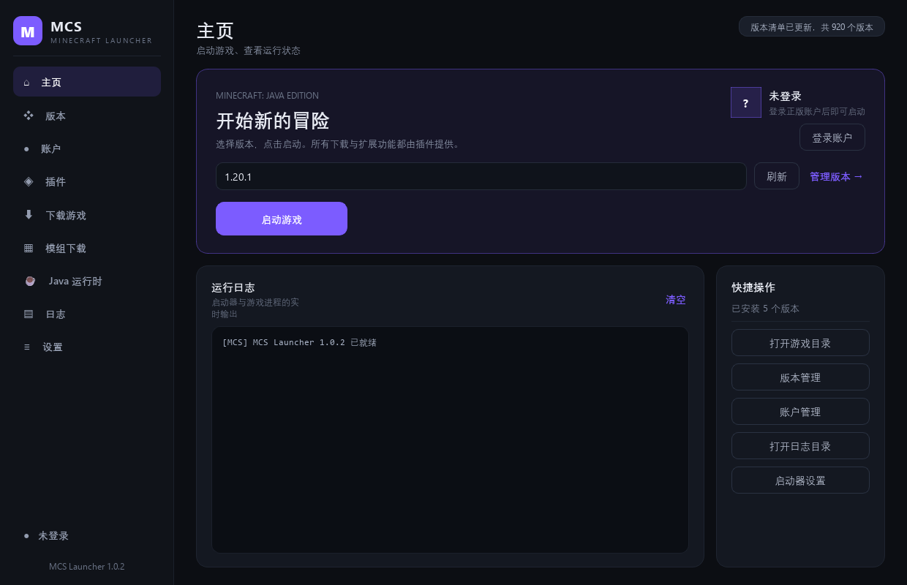
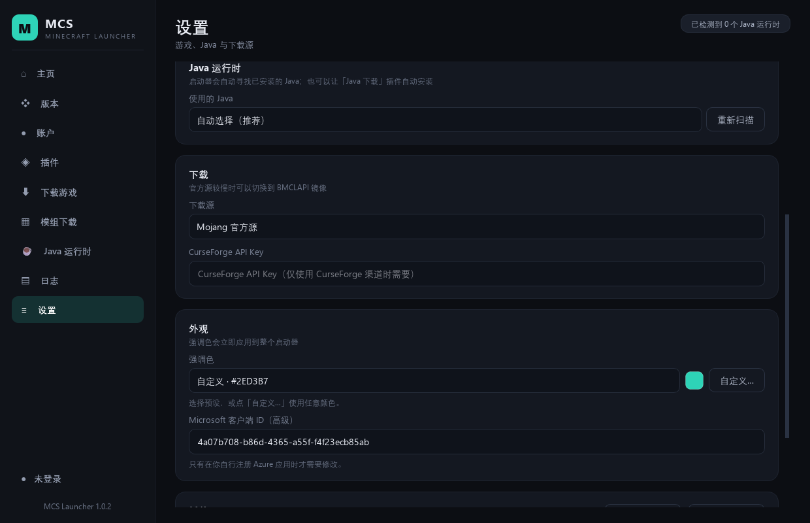
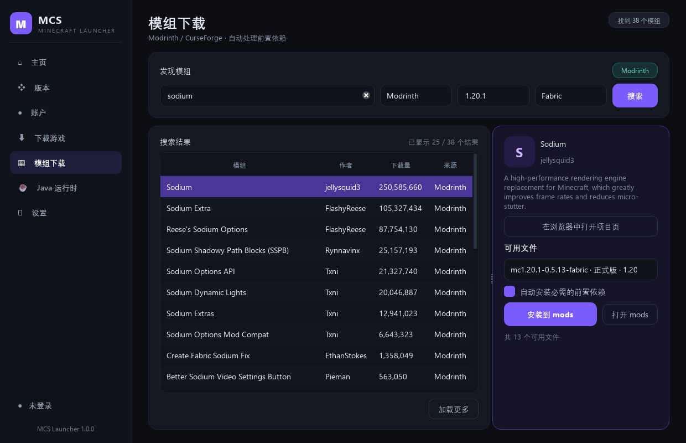
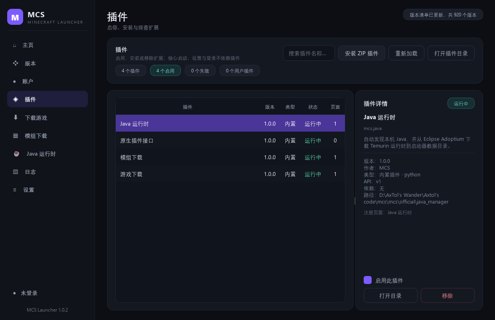
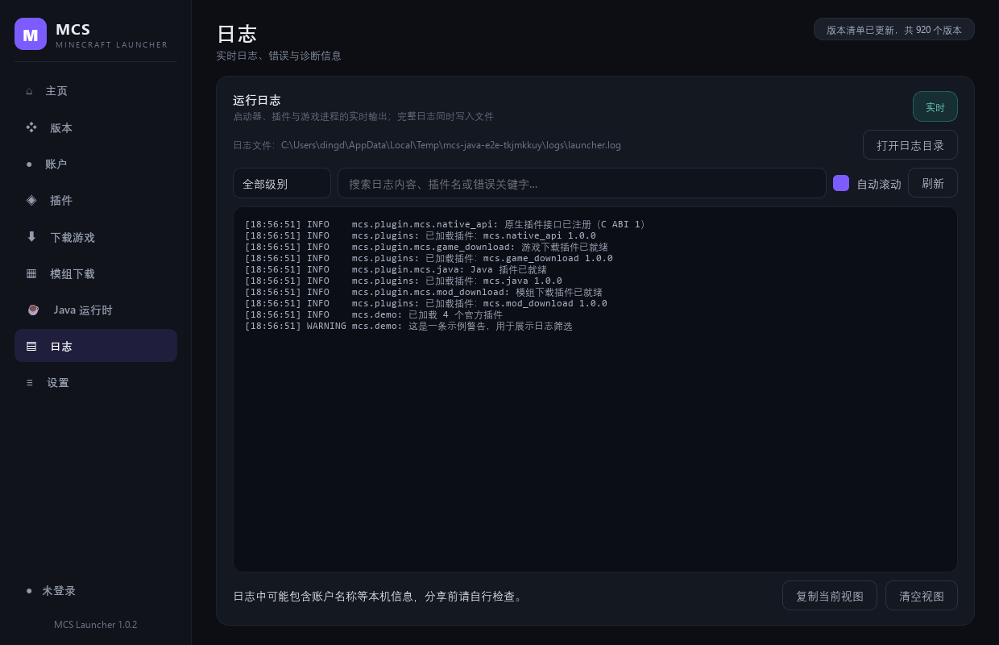
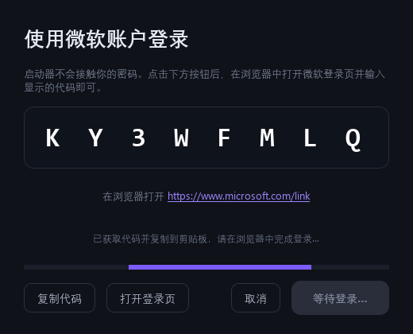

# MCS Launcher

一个用 **Python + PyQt6** 编写的现代化 Minecraft 启动器。核心只保留三件事：**启动游戏、基础设置、正版登录**；游戏下载、模组下载、Java 管理以及 C/C++ 插件接口全部通过插件实现。



## 功能

### 核心（启动器内核）
- 启动/停止 Minecraft，合并 `inheritsFrom` 版本继承，处理 classpath、natives、assets、日志配置和参数替换。
- 基础设置：游戏目录、内存、JVM/游戏参数、全屏、下载源、强调色（预设或任意自定义颜色）、Java 路径、插件启停。
- 微软正版登录：OAuth 2.0 设备代码流程（MSA → Xbox Live → XSTS → Minecraft Services → 玩家档案），刷新令牌与访问令牌使用 Windows DPAPI 加密保存。
- 版本列表：自动识别原版与 Forge / NeoForge / Fabric / Quilt。

设置中的「外观 → 强调色」支持紫罗兰、青碧、蔚蓝、珊瑚、琥珀等预设，也可以点「自定义…」从任意颜色中取色；选择会立即应用到按钮、导航、图标和选中项，并自动调整前景文字对比度。



### 官方插件（位于 `mcs/official/`，可禁用/卸载）
| 插件 | 说明 |
| --- | --- |
| 游戏下载 `mcs.game_download` | 从 Mojang 下载原版游戏与资源；安装 Forge / NeoForge / Fabric / Quilt，自动处理安装器 processors、打补丁客户端与依赖库。 |
| 模组下载 `mcs.mod_download` | 从 Modrinth / CurseForge 搜索、筛选并安装模组，支持自动安装必需前置依赖。 |
| Java 运行时 `mcs.java` | 发现本机 Java，或从 Eclipse Adoptium（Temurin）自动下载 JRE；也可作为服务供游戏下载插件调用。 |
| 原生插件接口 `mcs.native_api` | 为 C / C++ 动态库提供稳定的 C ABI 加载器。它本身就是一个 Python 插件，可按需禁用。 |

> 原生接口不是一个硬编码进内核的功能，而是通过 `PluginHost.register_kind_handler("native", ...)` 注册的插件；C/C++ 插件依赖它才能加载。



## 错误、日志与插件管理

- **统一错误弹窗**：未捕获异常、启动失败、插件安装/移除失败都会显示同一个错误对话框，支持展开完整 traceback、复制详情和打开日志目录；非致命错误以非模态窗口展示，不打断当前操作。
- **日志页面**：实时展示启动器、插件与游戏进程日志，支持级别筛选、关键字搜索、自动滚动、复制当前视图；日志同时写入 `logs/launcher.log`（4 MB 滚动，保留 5 份）。
- **插件管理**：查看插件状态/版本/类型/注册页面/错误，启用或禁用后即时重载；支持从 ZIP 安装、覆盖安装、移除用户插件，并汇总无法读取的插件清单。ZIP 安装会拒绝路径穿越、符号链接、超大解压体积和无效 manifest。





## 快速开始

要求 **Python 3.10+**（本项目在 Python 3.14 + PyQt6 6.11 上开发验证），Windows 10/11。

```powershell
python -m venv .venv
.\.venv\Scripts\Activate.ps1
pip install -r requirements.txt
python main.py
```

首次使用：

1. 打开「设置」确认游戏目录、内存和下载源。
2. 打开「Java 运行时」：扫描本机 Java，或下载一个 JRE（安装游戏时也会自动按版本要求下载）。
3. 打开「下载游戏」安装原版；需要模组就安装 Forge / NeoForge / Fabric / Quilt。
4. 打开「账户」使用微软账户登录。
5. 回「主页」选择版本并启动。

## 正版登录说明



登录使用设备代码流程：启动器显示一个代码，在浏览器打开 <https://www.microsoft.com/link> 输入代码即可，无需在启动器内输入密码。

默认客户端 ID 是一个公共 Azure 应用 ID，开箱即用；如果你要正式分发或希望登录记录归属自己的应用，请：

1. 在 [Azure Portal](https://portal.azure.com) 注册应用；
2. 在「身份验证」中允许 **公共客户端流**；
3. 把「应用程序(客户端) ID」填入「设置 → Microsoft 客户端 ID」。

如果登录提示 `AADSTS700016`，说明当前客户端 ID 不可用，请替换为自己的 Azure 应用 ID。

令牌保存在启动器数据目录的 `accounts.dat` 中，Windows 下使用 DPAPI 加密；关闭启动器不会退出微软账户。

## 插件开发

### Python 插件

把插件目录放到：

```text
%APPDATA%\MCSLauncher\plugins\<插件目录>\
```

目录内至少包含 `plugin.json` 与入口 Python 文件：

```json
{
  "id": "com.example.hello",
  "name": "Hello Plugin",
  "version": "1.0.0",
  "api": 1,
  "kind": "python",
  "entry": "plugin.py",
  "priority": 100
}
```

```python
# plugin.py
from mcs.api import HOOK_APP_READY

class HelloPlugin:
    def on_load(self, ctx):
        self.ctx = ctx
        ctx.register_hook(HOOK_APP_READY, self.ready)
        ctx.add_page(
            "hello",
            "Hello",
            lambda _context=None: self.build_page(),
            icon="✦",
            subtitle="一个最小插件页面",
            order=500,
        )

    def ready(self, **_kwargs):
        self.ctx.logger.info("启动器就绪")

    def build_page(self):
        from PyQt6.QtWidgets import QLabel, QVBoxLayout, QWidget
        page = QWidget()
        layout = QVBoxLayout(page)
        layout.addWidget(QLabel("这个页面完全由插件提供。"))
        return page

def setup(ctx):
    return HelloPlugin()
```

完整可运行示例见 [`sdk/python/example_plugin`](sdk/python/example_plugin)，接口文档见 [`sdk/README.md`](sdk/README.md)。

关键约定：

- `setup(ctx)` 返回插件实例，宿主随后调用一次 `on_load(ctx)`；卸载时调用 `on_unload()`。
- 页面工厂会收到一个 `context` 参数，建议写成 `lambda _context=None: ...`。
- 耗时操作放 `ctx.tasks.run(fn, ...)`，回调会自动切回 UI 线程。
- 插件可使用相对导入（例如 `from .ui import build_page`）。
- 可用服务通过 `ctx.services.register("name", obj)` 暴露给其他插件，例如 Java 插件注册了 `"java"`。
- 钩子常量见 `mcs/api/hooks.py`：`app.ready`、`app.closing`、`account.changed`、`launch.pre`、`launch.started`、`launch.log`、`launch.finished`、`settings.changed`、`game.version_installed`、`mod.installed`。

### C / C++ 原生插件

原生插件的 `plugin.json` 使用 `"kind": "native"`，入口是 `.dll`（Windows）或 `.so`（Linux）。需要启用官方插件「原生插件接口」。

SDK 位于 [`sdk/native/mcs_plugin.h`](sdk/native/mcs_plugin.h)，示例位于 [`sdk/native/example_plugin`](sdk/native/example_plugin)：

```powershell
# MSVC
sdk\native\example_plugin\build_msvc.bat
# MinGW / GCC
sdk\native\example_plugin\build_gcc.sh
```

ABI 采用 UTF-8 字符串、稳定结构体布局和 `MCSPluginV1` 入口表；宿主提供日志、钩子、设置、插件数据目录、游戏目录、全盘文本读取、受限写入、HTTP GET 与事件广播。C/C++ 插件目前不直接提供 Qt 页面（可由 Python 插件代为展示），但可以通过钩子、文件与网络扩展功能。

## 目录与权限

| 内容 | 默认位置 |
| --- | --- |
| 启动器数据 | `%APPDATA%\MCSLauncher`（可用 `MCS_DATA_DIR` 覆盖） |
| 设置 | `%APPDATA%\MCSLauncher\settings.json` |
| 账户（DPAPI 加密） | `%APPDATA%\MCSLauncher\accounts.dat` |
| 日志 | `%APPDATA%\MCSLauncher\logs\launcher.log` |
| 默认游戏目录 | `%APPDATA%\MCSLauncher\game` |
| 用户插件 | `%APPDATA%\MCSLauncher\plugins` |
| 插件私有数据 | `%APPDATA%\MCSLauncher\plugin-data\<插件 id>` |
| 托管 Java | `%APPDATA%\MCSLauncher\java` |

权限模型：

- **读取**：可读取本机任意文件（用于导入整合包、读取日志等）。
- **写入/删除**：仅限游戏目录、启动器数据目录和插件自己的 `plugin-data` 子目录；越界会抛出 `FileAccessError`。
- 网络下载默认走 Mojang / Modrinth / CurseForge / Adoptium。选择 BMCLAPI 时逐文件回退官方源；Forge 使用官方 Maven，NeoForge 优先使用可达镜像并回退 Maven Central / 官方源。

## 项目结构

```text
main.py                    入口
mcs/
  api/                     插件公共 API：类型、接口、钩子、常量
  core/                    设置、账户、启动、Java、网络、文件系统、任务、日志
  ui/                      主窗口、页面、主题、错误弹窗、日志页、插件管理页
  plugins_host/            插件发现、加载、生命周期、服务注册表、ZIP 安装器
  official/                官方插件（游戏下载、模组下载、Java、原生接口）
sdk/
  python/example_plugin/   Python 插件示例
  native/                  C ABI 头文件与示例
  README.md                插件开发文档
```

## 开发与验证

```powershell
.\.venv\Scripts\python.exe -m compileall -q mcs
.\.venv\Scripts\python.exe -m unittest discover -s tests -v
```

构建 Windows 独立运行目录和发布压缩包：

```powershell
pip install pyinstaller pillow
.\.venv\Scripts\python.exe tools\build_release.py
```

产物位于 `dist\MCSLauncher\MCSLauncher.exe` 与 `release\MCSLauncher-<版本>-win64.zip`。压缩包内是完整的 `MCSLauncher` 目录：`MCSLauncher.exe`、`_internal` 运行时，以及完整源码、SDK、测试与文档；`release\*.sha256` 是对应压缩包的校验值。

> `MCSLauncher.exe` 必须与同目录的 `_internal` 文件夹保持相对位置，不能单独复制出来。采用 onedir 形式后，启动时不再需要解包临时目录，放到普通目录或只读目录都能直接运行。

已验证内容：

- 原版 1.20.1 / 1.21.1、Fabric 0.20.1、Forge 47.4.28、NeoForge 21.1.264 的安装与启动命令构建；
- 原版、Fabric、Forge、NeoForge 实际启动进入渲染线程；主页启动按钮、日志与停止流程已实测；
- Java 17 / 21 自动下载并由 `JavaRegistry` 识别；
- Modrinth 搜索与 Sodium 模组下载；
- 微软设备码申请与登录对话框；真实账号授权需要你自行完成；
- Python 插件加载、页面注册、钩子、后台任务、文件写入；
- 原生 C 插件经 Zig 编译后加载，`app.ready` 钩子写入事件日志；
- 错误弹窗、实时日志页、插件管理页的界面冒烟；
- 插件 ZIP 安装/覆盖/路径穿越拦截/卸载的单元测试。

## 已知限制

- CurseForge 搜索需要自备 API Key（设置页填写）；未填写时界面会提示。
- 微软登录依赖公共客户端 ID，正式分发建议使用自己的 Azure 应用。
- 原生插件接口以 Windows 为主要目标平台；其他平台需要自行验证 `.so` 加载与 ABI。
- 启动器不做整合包（Modpack）安装；该能力适合作为额外插件实现。
